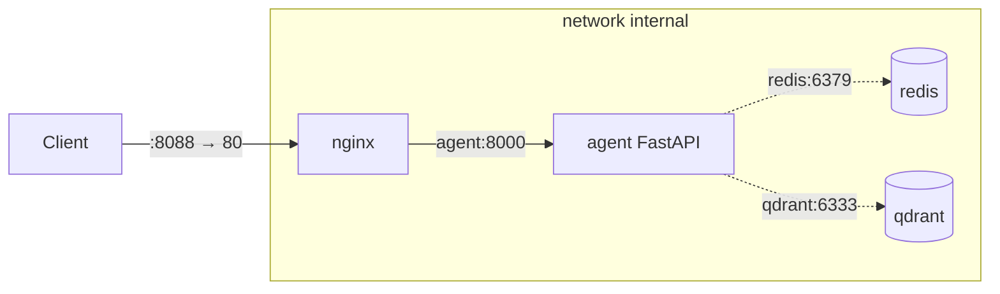

# Day 14 Lab - Mission Answers

Môi trường: Ubuntu 24.04 trên WSL2, Python 3.12.3 (`os.name` = `posix`), Docker Compose v5.7.0.

## Part 1: Localhost vs Production

### Exercise 1.1: Anti-patterns trong `develop/app.py`

| # | Dòng | Vấn đề | Hậu quả | Cách sửa trong `production/` |
|---|---|---|---|---|
| 1 | 17–18 | Hardcode API key và mật khẩu database | Push lên GitHub là lộ; xoá đi vẫn còn trong lịch sử git | Đọc từ env: `config.py` dòng 27, 32 |
| 2 | 34 | In API key ra log | Ai đọc được log đều lấy được key | Chỉ log độ dài câu hỏi và IP: `app.py` dòng 111–115 |
| 3 | 33, 34, 38 | Dùng `print()` | Không có level, timestamp; khó lọc và cảnh báo | `logging` có cấu trúc: `app.py` dòng 28–31 |
| 4 | 21–22 | Hardcode `DEBUG`, `MAX_TOKENS` | Đổi môi trường phải sửa code | `config.py` dòng 19, 29 |
| 5 | 42–43 | Không có health check | Platform không biết app hỏng để restart | `/health`, `/ready`: `app.py` dòng 135–161 |
| 6 | 51 | Bind `localhost` | Bên ngoài container không gọi vào được | `0.0.0.0`: `config.py` dòng 17 |
| 7 | 52 | Cố định cổng 8000 | Không nhận `PORT` do Railway/Render cấp | `config.py` dòng 18 |
| 8 | 53 | Luôn bật `reload=True` | Thêm tiến trình theo dõi file, không hợp production | Chỉ reload khi `DEBUG=true`: `app.py` dòng 198 |

### Exercise 1.2: Chạy bản develop

Gọi agent:

```bash
curl -i -X POST "http://localhost:8000/ask?question=Hello"
```

```text
INFO:     127.0.0.1:57712 - "POST /ask?question=Hello HTTP/1.1" 200 OK
```

Gọi health check, endpoint này không tồn tại trong bản develop:

```bash
curl -i http://localhost:8000/health
```

```text
INFO:     127.0.0.1:56170 - "GET /health HTTP/1.1" 404 Not Found
```

Log server khi xử lý `/ask`:

```text
[DEBUG] Got question: Hello
[DEBUG] Using key: sk-hardcoded-fake-key-never-do-this
[DEBUG] Response: Đây là câu trả lời từ AI agent (mock). Trong production, đây sẽ là response từ OpenAI/Anthropic.
```

**Nhận xét:** agent trả lời được nhưng chưa production-ready. Dòng 34 ghi API key vào log và app không có `/health`.

### Exercise 1.3: So sánh với bản production

Chuẩn bị và chạy:

```bash
cp .env.example .env
sed -i 's/^APP_NAME=.*/APP_NAME="AI Agent"/' .env
set -a; source .env; set +a
OPENAI_API_KEY=mock python app.py    # giá trị giả, app vẫn dùng mock LLM
```

Kết quả:

```bash
curl -i http://localhost:8000/health
curl -i http://localhost:8000/ready
curl -i -X POST http://localhost:8000/ask -H "Content-Type: application/json" -d '{"question":"Hello"}'
curl -i -X POST http://localhost:8000/ask -H "Content-Type: application/json" -d '{}'
```

```text
INFO:     127.0.0.1:58840 - "GET /health HTTP/1.1" 200 OK
INFO:     127.0.0.1:43094 - "GET /ready HTTP/1.1" 200 OK
{"time":"2026-11-25 17:08:46,311","level":"INFO","msg":"{"event": "agent_request", "question_length": 5, "client_ip": "127.0.0.1"}"}
{"time":"2026-11-25 17:08:46,442","level":"INFO","msg":"{"event": "agent_response", "response_length": 96}"}
INFO:     127.0.0.1:42048 - "POST /ask HTTP/1.1" 200 OK
INFO:     127.0.0.1:44486 - "POST /ask HTTP/1.1" 422 Unprocessable Entity
```

Log khi nhấn Ctrl+C:

```text
INFO:     Waiting for application shutdown.
{"time":"2026-11-25 17:11:09,515","level":"INFO","msg":"Agent shutting down gracefully — finishing in-flight requests..."}
{"time":"2026-11-25 17:11:09,616","level":"INFO","msg":"Shutdown complete"}
INFO:     Application shutdown complete.
INFO:     Finished server process [3547]
```

Đổi cổng bằng biến môi trường, không sửa code (`PORT=9000 python app.py`):

```text
INFO:     Uvicorn running on http://0.0.0.0:9000 (Press CTRL+C to quit)
INFO:     127.0.0.1:42282 - "GET /health HTTP/1.1" 200 OK
```

| Feature | Develop | Production | Tại sao quan trọng? |
|---|---|---|---|
| Config | Hardcode (dòng 17–22) | Env vars (`config.py` dòng 17–35) | Không lộ secret; một bản code chạy ở mọi môi trường |
| Health check | Không có | `/health` và `/ready` | `/health` giúp platform biết khi nào restart; `/ready` giúp load balancer biết khi nào gửi traffic |
| Logging | `print()`, lộ key | `logging` có cấu trúc, không log secret | Tìm kiếm, cảnh báo được; log không làm lộ dữ liệu |
| Shutdown | Chỉ dựa vào cơ chế mặc định của Uvicorn | Lifespan tắt cờ ready và có bước dọn dẹp (dòng 63–67) | Không cắt ngang request khi deploy lại |
| Host/Port | `localhost:8000` cố định | `0.0.0.0` và `PORT` từ env | Chạy được trong container và trên cloud |
| Input | `question` qua query | JSON body, thiếu `question` trả 422 (dòng 104–108) | Query string thường bị ghi vào access log và giới hạn độ dài |

**Điểm bản production vẫn chưa tốt (đọc từ code):**

1. `app.py` và `config.py` không gọi `load_dotenv()` dù có `python-dotenv` trong `requirements.txt`, nên phải tự nạp `.env` vào shell.
2. Khi thiếu `OPENAI_API_KEY`, `config.py` dòng 45 gọi `logging.warning()` trước `logging.basicConfig()` ở `app.py` dòng 28. Root logger đã có handler nên cấu hình JSON bị bỏ qua và log INFO không hiện.
3. `.env.example` có `APP_NAME=AI Agent` không ngoặc kép, nên `source .env` báo `Agent: command not found`.
4. Log ghép JSON vào chuỗi trong trường `msg` mà không escape dấu ngoặc kép, nên các dòng log này không phải JSON hợp lệ.

### Checkpoint 1

- **Hardcode secret nguy hiểm vì** key nằm vĩnh viễn trong lịch sử git; khi lộ phải thu hồi và tạo key mới.
- **Biến môi trường** tách cấu hình khỏi code, đổi giá trị không cần build lại.
- **Health check** cho platform biết app còn sống và sẵn sàng hay chưa.
- **Graceful shutdown** là ngừng nhận request mới, xử lý xong request đang chạy rồi mới đóng kết nối và thoát.

## Part 2: Docker

### Exercise 2.1: Dockerfile questions (`02-docker/develop/Dockerfile`)

1. **Base image:** `python:3.11` (dòng 8), bản Python đầy đủ.
2. **Working directory:** `/app` (dòng 11).
3. **Tại sao COPY `requirements.txt` trước (dòng 14) rồi mới COPY code (dòng 20)?** Docker cache theo layer, một layer đổi thì các layer sau phải build lại. Khi chỉ sửa code, `requirements.txt` không đổi nên bước `pip install` (dòng 17) dùng lại cache, build nhanh hơn. Nếu đặt `COPY . .` lên trước, mỗi lần sửa code đều phải cài lại thư viện.
4. **CMD vs ENTRYPOINT:** `CMD` là lệnh mặc định, bị thay thế khi thêm lệnh vào cuối `docker run` (ví dụ `docker run my-agent:develop whoami`). `ENTRYPOINT` là lệnh cố định, phần thêm vào trở thành tham số của nó (chỉ đổi được bằng `--entrypoint`). Dockerfile này dùng `CMD ["python", "app.py"]` (dòng 30).

### Exercise 2.2: Build và run

```bash
docker build -f 02-docker/develop/Dockerfile -t my-agent:develop .
docker run -d --rm --name agent-dev -p 8000:8000 my-agent:develop
curl -i -X POST "http://localhost:8000/ask?question=What%20is%20Docker"
curl -i http://localhost:8000/health
docker exec agent-dev whoami
```

`POST /ask`:

```text
HTTP/1.1 200 OK
date: Wed, 25 Nov 2026 10:29:49 GMT
server: uvicorn
content-length: 103
content-type: application/json

{"answer":"Container là cách đóng gói app để chạy ở mọi nơi. Build once, run anywhere!"}
```

`GET /health`:

```text
HTTP/1.1 200 OK
date: Wed, 25 Nov 2026 10:29:59 GMT
server: uvicorn
content-length: 54
content-type: application/json

{"status":"ok","uptime_seconds":38.1,"container":true}
```

`docker exec agent-dev whoami`:

```text
root
```

Log server trong container:

```text
INFO:     Started server process [1]
INFO:     Waiting for application startup.
INFO:     Application startup complete.
INFO:     Uvicorn running on http://0.0.0.0:8000 (Press CTRL+C to quit)
INFO:     172.17.0.1:43246 - "POST /ask?question=What%20is%20Docker HTTP/1.1" 200 OK
INFO:     172.17.0.1:33568 - "GET /health HTTP/1.1" 200 OK
```

### Exercise 2.3: Image size comparison

```bash
docker build -f 02-docker/production/Dockerfile -t my-agent:advanced .
docker images my-agent
```

```text
IMAGE               ID             DISK USAGE   CONTENT SIZE
my-agent:advanced   17c6419c6c0a        240MB         57.4MB
my-agent:develop    174e3690cb51       1.67GB          426MB
```

- Develop: **1668 MB** (cột DISK USAGE; `docker image inspect` báo 1 667 796 586 byte)
- Production: **240 MB** (cột DISK USAGE; `docker image inspect` báo 239 815 469 byte)
- Difference: (1668 − 240) / 1668 × 100 = **giảm 85,6%**

**Stage 1 `builder` (dòng 16–29)** cài `gcc`, `libpq-dev` và thư viện Python vào `/root/.local`.

**Stage 2 `runtime` (dòng 36–72)** bắt đầu lại từ `python:3.11-slim`, chỉ copy thư viện đã cài (dòng 45) và code, rồi chạy bằng `appuser` (dòng 58).

**Tại sao nhỏ hơn:**

1. Base image là `slim` thay vì bản đầy đủ. Riêng mức chênh này đã là lý do lớn, vì develop cũng chỉ cài hai thư viện nhỏ.
2. `gcc`, `libpq-dev` chỉ nằm ở stage `builder`, không có trong image cuối.

Ngoài kích thước, bản production an toàn hơn vì không chạy bằng root (`Config.User` của image là `appuser`, bản develop để trống nên là root) và có `HEALTHCHECK`.

### Exercise 2.4: Docker Compose stack



**Services được start:** `agent`, `redis`, `qdrant`, `nginx`.

- `agent` đợi `redis` và `qdrant` healthy rồi mới chạy (`depends_on` + `condition: service_healthy`).
- Các service gọi nhau bằng tên service (DNS nội bộ của Docker) trong network `internal`.
- Chỉ `nginx` mở cổng ra ngoài; agent, Redis và Qdrant không truy cập trực tiếp từ máy host.
- Nét đứt: agent được cấp `REDIS_URL` và `QDRANT_URL` nhưng `main.py` hiện chưa gọi hai service này.

**Lỗi gặp phải:** cổng 80 trên Windows đã bị IIS (W3SVC) sử dụng nên Nginx không publish được (`ports are not available: exposing port TCP 0.0.0.0:80`). Cách xử lý là file Compose override ánh xạ `8088:80`; Nginx vẫn lắng nghe cổng 80 bên trong container.

```yaml
# ~/cp2-ports.yml (ngoài repo)
services:
  nginx:
    ports: !override
      - "8088:80"
```

```bash
touch .env.local
docker compose -p k5-day14-docker up -d --build     # lỗi cổng 80
docker compose -p k5-day14-docker -f docker-compose.yml -f ~/cp2-ports.yml up -d
docker compose -p k5-day14-docker ps
```

Output `up -d` (lần chạy với file override):

```text
time="2026-11-25T21:32:15+07:00" level=warning msg="/home/haibac/day14/02-docker/production/docker-compose.yml: the attribute `version` is obsolete, it will be ignored, please remove it to avoid potential confusion"
 Network k5-day14-docker_internal Creating 
 Network k5-day14-docker_internal Creating 
 Network k5-day14-docker_internal Created 
 Network k5-day14-docker_internal Created 
 Container k5-day14-docker-qdrant-1 Creating 
 Container k5-day14-docker-redis-1 Creating 
 Container k5-day14-docker-redis-1 Created 
 Container k5-day14-docker-qdrant-1 Created 
 Container k5-day14-docker-agent-1 Creating 
 Container k5-day14-docker-agent-1 Created 
 Container k5-day14-docker-nginx-1 Creating 
 Container k5-day14-docker-nginx-1 Created 
 Container k5-day14-docker-qdrant-1 Starting 
 Container k5-day14-docker-redis-1 Starting 
 Container k5-day14-docker-qdrant-1 Started 
 Container k5-day14-docker-qdrant-1 Waiting 
 Container k5-day14-docker-redis-1 Started 
 Container k5-day14-docker-redis-1 Waiting 
 Container k5-day14-docker-qdrant-1 Healthy 
 Container k5-day14-docker-redis-1 Healthy 
 Container k5-day14-docker-agent-1 Starting 
 Container k5-day14-docker-agent-1 Started 
 Container k5-day14-docker-nginx-1 Starting 
 Container k5-day14-docker-nginx-1 Started
```

Output `ps`, cả 4 service đều `Up`, chỉ nginx publish cổng:

```text
NAME                       IMAGE                   COMMAND                  SERVICE   CREATED          STATUS                    PORTS
k5-day14-docker-agent-1    k5-day14-docker-agent   "uvicorn main:app --…"   agent     23 seconds ago   Up 10 seconds (healthy)   8000/tcp
k5-day14-docker-nginx-1    nginx:alpine            "/docker-entrypoint.…"   nginx     22 seconds ago   Up 9 seconds              0.0.0.0:8088->80/tcp, [::]:8088->80/tcp
k5-day14-docker-qdrant-1   qdrant/qdrant:v1.9.0    "./entrypoint.sh"        qdrant    23 seconds ago   Up 22 seconds (healthy)   6333-6334/tcp
k5-day14-docker-redis-1    redis:7-alpine          "docker-entrypoint.s…"   redis     23 seconds ago   Up 21 seconds (healthy)   6379/tcp
```

Test qua Nginx, và gọi thẳng agent ở cổng 8000 (không được mở ra ngoài):

```bash
curl -i http://localhost:8088/health
curl -i -X POST http://localhost:8088/ask -H "Content-Type: application/json" -d '{"question":"Explain microservices"}'
curl -i http://localhost:8000/health
```

`GET /health` qua Nginx:

```text
HTTP/1.1 200 OK
Server: nginx
Date: Wed, 25 Nov 2026 14:32:49 GMT
Content-Type: application/json
Content-Length: 96
Connection: keep-alive
X-Frame-Options: DENY
X-Content-Type-Options: nosniff
X-XSS-Protection: 1; mode=block

{"status":"ok","uptime_seconds":17.7,"version":"2.0.0","timestamp":"2026-11-25T14:32:49.625055"}
```

`POST /ask` qua Nginx:

```text
HTTP/1.1 200 OK
Server: nginx
Date: Wed, 25 Nov 2026 14:32:49 GMT
Content-Type: application/json
Content-Length: 95
Connection: keep-alive
X-Frame-Options: DENY
X-Content-Type-Options: nosniff
X-XSS-Protection: 1; mode=block

{"answer":"Agent đang hoạt động tốt! (mock response) Hỏi thêm câu hỏi đi nhé."}
```

Gọi thẳng agent ở cổng 8000, kết nối bị từ chối vì chỉ Nginx mở cổng ra ngoài:

```text
curl: (7) Failed to connect to localhost port 8000 after 17 ms: Couldn't connect to server
```

### Checkpoint 2

- **Multi-stage** giảm dung lượng bằng cách bỏ công cụ build khỏi image chạy thật.
- **Compose** khai báo các service, network, volume và thứ tự khởi động trong một file.
- **Debug container:** `docker logs` xem log, `docker exec` chạy lệnh bên trong container đang chạy.

## AI log

| Phần | Hỏi gì | Nhận gì | Tự sửa / tự kiểm tra thế nào |
|---|---|---|---|
| CP0 | Docker không chạy trong WSL | Claude chỉ ra chưa bật WSL integration và cách bật | Bật tích hợp, Docker chạy được trong Ubuntu |
| Part 1 | Hướng dẫn CP1 và soạn báo cáo | Claude giải thích lệnh, soạn bản nháp phần phân tích của Part 1 (bảng anti-pattern, bảng so sánh, nhận xét) | Kiểm tra lại log trong ubuntu và đối chiếu với file .md |
| Part 2 | Hướng dẫn CP2, lỗi cổng 80, soạn báo cáo | Claude tìm ra IIS chiếm cổng 80, đưa file override `8088:80`; chạy `docker images` để lấy kích thước hai image đã build; soạn bản nháp phần phân tích | [TỰ GHI: đã đối chiếu và sửa gì] |
